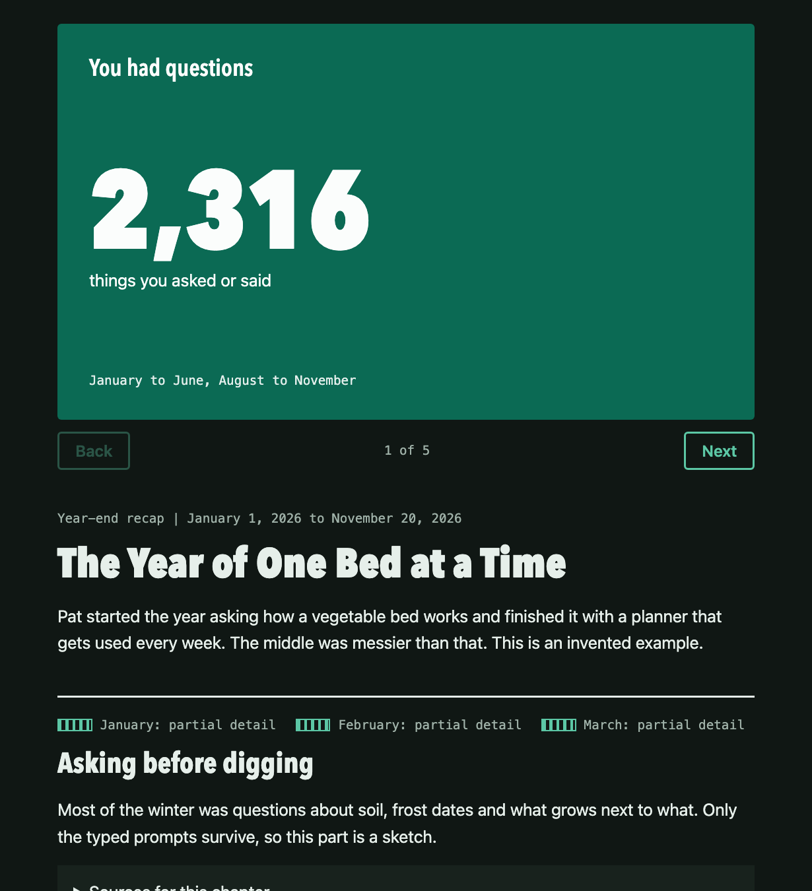

# Year Recap

Ask Claude Code for your year and get a page about it: a few slides of fun facts, the story of what you worked on and how it changed, and the lessons worth keeping. It runs any day. A run in July gives you a mid-year recap.

Your page is private. It is saved on your computer and, unless you say "don't publish it", published to your own claude.ai account, where only you can open it until you choose to share it.



That is the start of a made-up example. To see the rest, open [`example/recap.html`](example/recap.html) on GitHub, click the download icon at the top right of the file, and open the downloaded file in a browser.

## What you need

- **Claude Code**, and some history with it.
- **A Mac.** Linux should work but hasn't been tested. Windows isn't supported.
- **Python 3.9 or later.** In a terminal, run `python3 --version`. If that fails or shows an older number, install Python from [python.org](https://www.python.org/downloads/) and try again.

There is no server, no API key and no extra cost beyond your Claude plan.

## Install

Paste these into a Claude Code session, one at a time:

```
/plugin marketplace add bronsonelliott/year-recap
```

```
/plugin install year-recap@year-recap
```

The second one opens a panel. Choose to install it for yourself, so it works in every folder. Then start a new session. To check, type `/plugin` and look for `year-recap` under installed plugins.

<details>
<summary>From a terminal instead</summary>

```bash
claude plugin marketplace add bronsonelliott/year-recap
```

```bash
claude plugin install year-recap@year-recap
```

Then start a new session.

</details>

<details>
<summary>Without the plugin system</summary>

On this project's GitHub page choose **Code**, then **Download ZIP**, and unzip it. Open a terminal in the unzipped folder. On a Mac, right-click the folder in Finder and choose **New Terminal at Folder**. Then run this. Running it again updates it.

```bash
mkdir -p ~/.claude/skills/year-recap && cp -R skills/year-recap/. ~/.claude/skills/year-recap/
```

</details>

## Make your recap

Start a new session in any folder and say:

> Make my year recap.

For an earlier year, name it: "Make my 2025 recap." If Claude doesn't seem to know what you mean, type `/year-recap:year-recap` (or `/year-recap` if you installed without the plugin system). Claude should start by telling you what history it found.

Claude Code will ask permission to run `recap.py` and to read and write in `~/.claude-year-recap`. Those are the skill's own command and folder, and it can't make a recap without them. It may ask more than once.

**It stops twice for your decisions.** If you run it in January, it first asks which year you mean.

1. **How big the job is.** Claude tells you what history it found and about how much of your plan the reading will use: roughly 500 tokens (pieces of words) for each session and 30 for each thing you typed. Say yes or no. If you say no, nothing has been saved. This is also where it reminds you the page will be published privately, and you can say "don't publish it." Type `/usage` to see what is left of your plan.

2. **What wasn't you.** Claude lists sessions that look automated, such as a nightly script, and gives each a label. It does the same for commits (saved changes to code) and for the email addresses on them. Answer with the labels:

   > a1 and c1 were automated, a2 was me, and e1 is my email.

   If you're not sure about one, say so and Claude will tell you more. It also asks whether you have notes or a changelog to include. To change an answer later, say "go back to the automated list." Some of your year may then need reading again.

**Then it reads.** Claude goes through your history in parts, which can take a while for a busy year, and offers to pause along the way. You can also stop any time: close the session whenever you like. What Claude has read so far is kept. To go on, say "continue my year recap" in any session.

**At the end** Claude gives you a link to the page, if it was published, and a list of things to check before you share it. The page is also a file, `recap.html`, in a folder named for the year inside `~/.claude-year-recap`. To open it, run this, replacing 2026 with your year:

```bash
open ~/.claude-year-recap/2026/recap.html
```

To change any wording, including names shown under a lesson's sources, ask Claude.

## What it reads, saves and sends

**It reads:**

| What | Where |
|---|---|
| Your Claude Code sessions | `~/.claude/projects` |
| What you typed into Claude Code | `~/.claude/history.jsonl` |
| Daily activity totals | `~/.claude/stats-cache.json` |
| Sessions from Cowork, the part of the Claude desktop app that works on files for you | `~/Library/Application Support/Claude/local-agent-mode-sessions` |
| Your own git commits | the folders you used Claude Code in, and up to four levels inside them |
| Notes or a changelog | only files you name |

Anything you don't have is skipped.

**It reads every session** except the automated ones you confirm. There is no setting to skip a folder or topic.

**Claude sees, and so Anthropic receives,** a shortened copy: your own messages, cut to 600 characters each; Claude's last reply in each session; session titles and folder names; the first line of your commits; and the notes you named. Your files and code are not included unless you pasted them into a message or they were in that last reply. Passwords and keys in common formats are removed first.

**It saves** that shortened copy, Claude's notes and your page in `~/.claude-year-recap`. Only your user account can open that folder.

**It publishes** only the finished page, to your own claude.ai account, unless you said not to. If your Claude Code can't publish pages, you get the file.

## Before you share your page

The page is candid. It can name people, clients and your employer, and mention health, money or family. Go through the list Claude gives you, and read the whole page too, because the list can miss things.

The filter for passwords and keys can also miss things: an unusual format, or a password in the middle of a sentence.

## Why early months can be thin

Claude Code deletes session transcripts after 30 days unless you change a setting. What you typed is kept, so the recap can still tell those months with less detail. Each month on the page shows how much survived.

To keep transcripts longer from now on, ask Claude Code: "Set cleanupPeriodDays to 365 in my user settings." It applies to new sessions and can't bring back what is already deleted. The recap never changes your settings.

## How it stays honest

- Code does the counting, and fills in every number on the slides.
- Every "worked" or "didn't work" lesson has to cite sessions, prompts, commits or notes. Click or tap one to see them. If one has no source, the page isn't made until Claude fixes it.
- If part of your year hasn't been read yet, the page says so.

## Known limits

- A test session you ran once or twice looks like any other session and is included.
- If you moved a project to a new folder, the two folders are counted separately.
- A month says "full detail" only when surviving sessions hold at least half of what you typed that month.
- Sessions from a second computer aren't included.
- The size estimate runs low for languages such as Chinese and Japanese.

## Update or remove

To update:

```bash
claude plugin marketplace update year-recap
```

```bash
claude plugin update year-recap@year-recap
```

To remove it, run this. It uninstalls the plugin too.

```bash
claude plugin marketplace remove year-recap
```

If you installed without the plugin system, remove it with this instead:

```bash
rm -r ~/.claude/skills/year-recap
```

If it says there is no such folder, it was already gone.

Your recaps stay until you delete them. This deletes every year's page and everything saved for it, so copy out any `recap.html` you want first. It prints nothing.

```bash
rm -r ~/.claude-year-recap
```

A page published to claude.ai is separate. Delete it there.

## For developers

Download or clone this project, and from its folder run the tests. They should end with `OK`.

```bash
python3 -m unittest discover -s tests
```

## License

MIT. See [LICENSE](LICENSE). This is an independent project, not made or endorsed by Anthropic.
